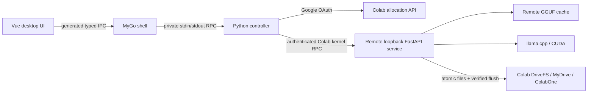

# ColabOne architecture

## Ownership and startup

The OS credential store holds Colab credentials, optional HF token, the exact owned session, and remote bearer. Plain settings contain GPU choice, CU budget, idle timeout and automatic Drive connection preference. Existing Yoga / colab-cli profiles are independent. A Google loopback login with PKCE and state validation returns automatically; a manual flow accepts a raw code, whole page or callback URL. Clipboard text is read only when the user clicks paste.

The exact endpoint is recorded immediately after allocation. A new allocation is released if rate detection, readiness or bootstrap fails. Automatic guards and rollback only release the owned instance. The explicit Stop All action previews every assignment on the current account, binds the reviewed endpoint set to that account, flushes the owned runtime unless force was selected, attempts every reviewed release, and re-reads assignments and billing. It does not chase instances created after the preview; remaining instances are reported for another review. Failure to verify release retains ownership so the user can retry.

The bootstrap installs the server independently of any model. A separate budget deadline process starts before pip installation. The service binds only to loopback 7860; llama-server binds to loopback 8081. Authenticated Colab kernel executions proxy control requests to the service; POST bodies are uploaded as short-lived files so credentials and prompts are not embedded in notebook source. One lock serializes kernel requests over a reused websocket; proxy-token changes reconnect without replaying mutations. No public inference port or VPN configuration is needed.

## Models and tasks

The HF API resolves revision, sizes and SHA-256 metadata. Import never downloads weight bytes to the desktop. Download jobs fetch directly into the remote cache, resume `.part` files, reject wrong Content-Range and hashes, and atomically publish verified files. Multiple cached models are retained; loading, unloading and switching never remove them. Explicit deletion is blocked for a loaded model or active task.

One task runs at a time. Engine deployment uses pinned release assets and SHA-256, then launches a supervised process with no shell interpolation. The remote engine health endpoint determines readiness. Invalid models and resource failures remain visible as failed tasks.

## Chat and persistence

The remote service owns conversations. It saves the user message before generating and periodically saves partial assistant output, then syncs JSON snapshots to Drive. Events have sequence IDs so desktop incremental polls resume without resubmitting a turn. Reopening the client refreshes remote snapshots; a new GPU restores snapshots from Drive, with all weight installation flags recomputed from the new runtime's actual filesystem.

Drive uses the official `google.colab.drive.mount()` mechanism, also wrapped by easycolab. The desktop implements the official Colab CLI credential-propagation handshake on a worker thread. Before opening a consent tab it tries real propagation using any existing grant. Only a valid Google challenge permits temporary HTTP 400 responses to be treated as pending, under the same cancellation/budget deadline. After the initial dry-run check it retries real propagation (`dryrun=false`) until explicit success, then sends a Colab reply to the waiting kernel. Consent opens at most once. The websocket receiver remains unblocked. Cancellation and deadlines always reply with an error. There is no separate Drive API project or OAuth client. Each fresh runtime may need browser consent.

JSON snapshots are written atomically to `/content/drive/MyDrive/ColabOne`; writes refuse to proceed if the mount is missing. Synchronization is serialized, and an update during an upload stays dirty for the next pass. Normal release cancels work, waits for final snapshots, then uses official `drive.flush_and_unmount()` before unassigning. Failed flush blocks normal release. Explicit force release acknowledges potential loss; unexpected Colab eviction may lose unsynced output. Drive access is only available while an owned runtime is mounted; offline client state is not a separate cloud reader. Model weights stay on Colab ephemeral storage.

## Lifetime and budget

One desktop controller monitors the owned instance and sends Colab heartbeats. Remote active download/load/chat prevents idle expiry; polling does not count as use. The independent deadline and the controller's balance check stop ahead of the requested CU budget to allow for release and billing lag. Defaults: T4, 5 CU per runtime, 180 seconds idle grace followed by a 60-second release countdown. Trusted pointer/key/scroll interactions enqueue a throttled activity command; snapshot polls and heartbeats never reset it. A bounded lease protects the browser Drive confirmation; neither activity nor tasks can extend the independent budget deadline. Expiry is decided by the remote service, so it works after the UI exits. Closing the window retains the tray/controller; quitting stops local heartbeat. Remote release protection remains, subject to Colab availability.

## Packaging

Go/MyGo shell, compiled Vue assets, pinned standalone CPython, hash-locked wheels, Python service modules and data manifests form one portable distribution. The two original notebooks/clients and local MCP tools are not required. Python and frontend checks run on both supported platforms; native manual checks and live GPU validation are reported separately.

## Desktop activity and saved login

Colab refresh tokens are stored in the OS vault. Refresh is serialized with account changes, and network errors retain saved authorization. The UI confirms whether automatic renewal is available. Native Drive grants remain runtime-specific; this is not a promise of permanent browserless Drive access.

A bounded 300-event desktop feed records lifecycle stages, remote task state changes and download transfer statistics every five seconds, file transitions, retries, SHA-256 checks and task completion. It never records prompts, HTTP bodies or authorization URLs; displayed errors are redacted. Identical polls do not append entries. The overlay drawer preserves workspace geometry and follows new entries until the user scrolls back, provides error filtering/copy/clear, and retains its open preference. Logs are held in memory for this app run. Billing uses a separately refreshed account assignment list and consumption rate; stale data stays visibly marked, and an absent owned runtime never implies a zero account rate.

## Parallel download and online catalog

`common/hub.py` queries only HF metadata, with GGUF filtering, bounded pagination and pinned commit revisions. Complete split GGUF sets are grouped into one choice; missing hashes/shards disable installation. Weight requests always originate on the GPU.

`server/download.py` adapts upstream's 64 MiB range / thread-pool approach. The pool is bounded to 8 or 32 workers per file. Completed ranges are fsynced before atomic resume metadata; sparse preallocation never counts as completed bytes. Cancellation retains completed ranges, old sequential partials can resume, ignored Range responses fall back to a single connection, malformed ranges cannot publish data. SHA-256 gates final atomic rename. A rolling wire-byte window reports rate, bytes, connections and ETA; resumed bytes do not inflate rate.

Protocol 2 exposes the new telemetry and idle policy. Older live services can update in place only without a running task or loaded model, preserving `/content/colabone-data`, the control token and the original deadline guard. A failed new service launch restores the previous code. The client never claims a new download policy is active on an old service.

## Creative engine and artifacts

Protocol 3 adds a second engine implementation under the same single-task/runtime lifecycle. `stable-diffusion.cpp` at commit `5dcfa79801213f23e27b3e83617350ebb8ea93aa` is built with CUDA, WebP and WebM support on the GPU. Its native async server listens only on loopback 8082. Llama and creative processes are mutually exclusive. Generation uses native image/video jobs and stops the process on cancellation or failure before exposing an idle runtime.

Creative manifests include diffusion weights, text encoder and VAE, with pinned revisions and hashes. User-selected references are decoded, pixel-limited, stripped of metadata and normalized to PNG. Outputs receive random immutable IDs, hash/size/MIME metadata and bounded chunk reads. A locked store serializes publication, cloud backup and recoverable deletion. Desktop previews keep only output bytes in memory; exports require a native destination dialog and full SHA-256 validation. Runtime release uploads artifacts through the existing Drive flush path. Neither creative jobs nor build steps extend the independent budget deadline.

## Public inference and Cloudflare

Protocol 4 adds `server/public_api.py`: a separate loopback gateway on remote port 7861 with mandatory external Bearer authentication and a strict inference route set. It shares the Runtime task lock and loaded engine; generation requests suppress idle expiry, model-list/status polling does not. Budget deadlines are unchanged. Turning off the API cancels its jobs and terminates only its owned connector, preserving the model for desktop use. Releasing the runtime closes the API before flushing data. Restarting/upgrading the remote service leaves public access off until explicitly enabled again.

`server/tunnel.py` installs the architecture-specific Cloudflared 2026.11.0 release on the GPU, verifying the GitHub release SHA-256 from `catalog/cloudflared.json`. No desktop tunnel process or local inference is installed. Named tunnel tokens use a mode-0600 token file, never command arguments, and are removed on stop/failure. Raw connector logs are not retained. Startup and periodic probes verify the public identity and both unauthorized/authenticated behavior; a log containing a URL alone never means ready. Shutdown signals only the Popen child; it does not use global pkill or adopt another project's connector. Quick tunnels are explicitly non-SSE; named tunnels support streamed chat. The desktop provides appropriate code examples for each mode and image/video async polling.
