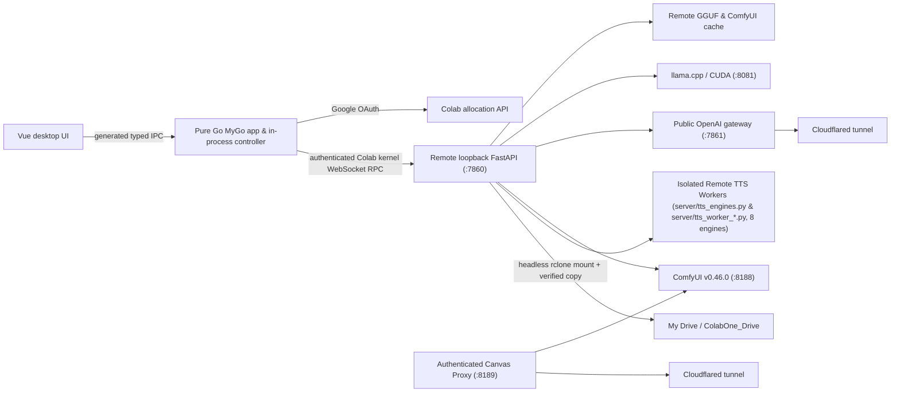

# ColabOne architecture

## Ownership and startup

The OS credential store holds Colab credentials (including the `drive.file` refresh token), optional Hugging Face token, managed runtime sessions, active endpoint, Public API credentials, and per-runtime bearer metadata. Plain settings store the default GPU choice, unified idle auto-release timeout (default **30 min**; selectable `15 min`, `30 min`, `45 min`, `1 hr`, or `2 hr` from either the **Devices** dropdown or **Settings**), automatic Drive mount preference, and download concurrency. Existing Colab CLI (`colab-cli`) profiles remain independent. A Google loopback login with PKCE and state validation returns automatically; a manual flow accepts a raw code, whole authorization page, or callback URL. Clipboard text is read only when the user clicks **Paste & Sign In**.

Each owned endpoint is recorded immediately after allocation. Multiple GPUs can be allocated, switched (`runtime.select`), monitored in parallel, and selectively released without affecting instances started in other clients. A new allocation is released if rate detection, readiness, or bootstrap fails, restoring the previous active managed instance if one exists. Automatic guards and rollback only release the owned instance. The release review dialog previews every assignment on the current account with hardware specs (`accelerator`, `variant`, `shape`), allowing either selective per-instance release (`endpoints`) or full **Stop All**, then re-reads assignments and billing. Active and listed instances automatically resolve their geographic country/region (mirrored in the Go desktop controller and `common/location.py` on the VM) from GCP zones and Colab endpoint codes—refined on the VM via GCP metadata (`metadata.google.internal`) and a lightweight HTTPS geo fallback, cached in `/content/colabone-data/location.json`—and render built-in vector SVG flags (`FlagIcon.vue`) in the top bar and **Devices** view with no external image fetches or OS emoji font dependencies.

The bootstrap uploads the remote Python control service (`server/`, `common/`, `catalog/`) embedded directly inside the Go desktop binary (`console/internal/servicebundle/embedded/` via `go:embed`) and installs it independently of any model or workflow engine. On the remote VM, loopback bindings are strictly separated by responsibility:
- `127.0.0.1:7860`: private control API (`/api/v1/*`), reached only through authenticated Colab kernel RPC;
- `127.0.0.1:8081`: `llama-server` (`llama.cpp` CUDA engine for GGUF LLMs);
- `127.0.0.1:7861`: separate public OpenAI-compatible text gateway fronted by Cloudflared;
- `127.0.0.1:8188`: `ComfyUI` workflow engine (`v0.46.0`, mutually exclusive in GPU VRAM with `llama-server`);
- `127.0.0.1:8189`: authenticated HTTP + WebSocket reverse proxy for the ComfyUI Native Canvas fronted by Cloudflared.

Authenticated Colab kernel executions proxy control requests to port `7860`; POST bodies are uploaded as short-lived files so credentials, workflows, and parameters are not embedded in notebook source. One lock serializes kernel requests over a reused pure Go WebSocket (`coder/websocket`); proxy-token changes reconnect without replaying mutations.

## Models and tasks

The desktop app organizes sidebar navigation into four views (**Devices**, **Public API**, **ComfyUI**, **Settings**). Legacy built-in desktop chat, image, and video pages and single-model `stable-diffusion.cpp` (`Z-Image Turbo`, `Wan2.2 5B`) creative recipes have been retired.

Single-model GGUF selection is integrated directly into **Public API** via the right-side **Select Model** slide-over drawer (`ModelDrawer.vue`; validated identically by the Go desktop controller and remote `common/models.py`, accepting only `.gguf` `model`/`shard` manifests) across a streamlined 2-tab layout—**My Models** and **Community**—with inline per-card remote download and VRAM status badges, unifying model discovery, saved model management, runtime parameters, and VRAM lifecycle directly within the API workflow. Starter repositories (`huihui-ai/Huihui-Qwen3.8-Flash-Next-abliterated-v2-GGUF`, `huihui-ai/Huihui-DeepSeek-V4.1-Flash-1017-abliterated-GGUF`, `JonathanColetti/Qwen3.8-27B-Uncensored`) are seeded once into `library.json`, and users can bookmark community repositories or models (**Save to My Models**) or remove them (**Remove from My Models**) even offline before starting a GPU. The Hugging Face API resolves commit revisions, file sizes, and SHA-256 metadata; importing never downloads weight bytes to the desktop. Download jobs fetch directly into the remote cache, resume `.part` files, reject invalid `Content-Range` responses or mismatched hashes, and atomically publish verified files—optionally chaining directly into a remote GPU VRAM load (`load=true`, **Download & Load**) with inline context length (`8K`–`128K`) and temperature settings. Multiple cached models are retained; loading, unloading, and quick switching never remove them. Explicit deletion is blocked while a model is loaded or part of an active task.

Engine deployment uses pinned release assets with SHA-256 verification and launches supervised processes without shell interpolation. Strict VRAM mutual exclusion is enforced between `llama-server` (`8081`) and `ComfyUI` (`8188`): starting or loading one stops or unloads the other before allocating GPU memory while preserving downloaded files. Invalid manifests and resource failures remain visible as failed tasks.

## Persistence and Drive sync

Each remote service owns its workspace metadata, imported workflows, and ComfyUI outputs on the remote VM disk (`/content/colabone-data`) and persists them automatically to `My Drive / ColabOne_Drive/workspace` using a hybrid dual-mode strategy with an identical Drive layout:
1. **Headless `rclone` mode (preferred when a Drive-enabled GCP quota project is available)**: When the user's Google account already has a Drive-enabled GCP project or supports auto-provisioning a free `colabone-drive-*` quota project (`X-Goog-User-Project`), ColabOne stages a mode-`0600` `[colabone_gdrive]` OAuth config (`scope = drive.file`) with the quota project directive and mounts/syncs via the pinned, SHA-256-verified `rclone` release (`catalog/rclone.json`) with zero per-instance browser prompts.
2. **Official Google Colab native DriveFS fallback (`colab_drivefs`)**: When Google's public ADC OAuth client (`764086051850-*`) has no available GCP quota project (e.g., personal accounts that have not accepted the Google Cloud Terms of Service or Workspace organizations restricting project creation), ColabOne automatically falls back to official `google.colab.drive.mount('/content/drive')` (`dfs_ephemeral` orchestrated by the in-process Go Drive mount controller) on a dedicated short-lived mount kernel, requiring a one-click browser confirmation per new instance and persisting directly into `/content/drive/MyDrive/ColabOne_Drive/workspace`.

Synchronized paths include `/models.json`, `/workflows/**`, and `/comfyui-outputs/**` (excluding temporary `.part*`/`.tmp*` files and `.trash/**`; deletions move remote workflow and output files into `.trash/`). Normal release shuts down active Public API/Native Canvas tunnels and engines, flushes dirty workspace files, and unmounts (`google.colab.drive.flush_and_unmount` or FUSE unmount) before unassigning. Model weights stay on Colab ephemeral storage.

The in-process Go controller refreshes expired runtime-proxy credentials before uploading or executing an RPC and runs its heartbeat before configuration. Kernel identity callbacks merge into the still-owned session instead of writing stale credentials or resurrecting a released session. Failed mutations are not replayed. Because the controller executes directly inside the Go desktop binary rather than behind a subprocess pipe, large snapshots and chunked asset reads flow directly over typed MyGo IPC with zero local Python bridge overhead. Workflow output previews and exports validate transfer metadata, MIME allowlists, size, and SHA-256 before returning content.

## Lifetime, telemetry and billing

One in-process Go desktop controller monitors the owned instance and sends Colab heartbeats. Single-launch CU budgets (`max_cu`) and mandatory per-runtime budget deadlines have been removed; automatic resource protection uses a unified configurable idle auto-release countdown defaulting to **30 min** (options: `15 min`, `30 min`, `45 min`, `1 hr`, `2 hr`), adjustable directly from the **Devices** dropdown or **Settings**. Default GPU selection defaults to `G4`. Active remote work—downloads, VRAM loads, Public API inference requests, and active ComfyUI queue runs or authenticated Native Canvas proxy requests—pauses the idle auto-release countdown; status/snapshot polling and heartbeats never count as activity. Trusted pointer, keyboard, and scroll interactions enqueue a throttled activity command that resets the idle countdown, and a bounded lease protects Drive operations when needed. Expiry is enforced by the remote service, so idle auto-release continues working even if the desktop UI exits. Closing the window keeps the tray and controller running; quitting stops local heartbeats while remote idle auto-release protection remains active, subject to Colab availability.

On the remote VM, `server/telemetry.py` (`ColabOneResourceSampler`) samples live hardware metrics—`gpu` utilization and VRAM, system `memory` from `/proc/meminfo`, `disk` capacity plus `/proc/diskstats` I/O throughput rate, `cpu` utilization from `/proc/stat`, and a 60-sample rolling `history`—and returns them under `resources` in `/api/v1/status` (and `/api/v1/snapshot`). On the desktop client, `ResourceMonitor.vue` renders ColabOne real-time hardware charts on the **Devices** view without resetting idle state, with an instance selector dropdown defaulting to this client's active managed GPU and automatically falling back to the first running remote account instance (preferring GPUs) when no local instance is active. **External** instances are observed strictly read-only via a dedicated isolated observer kernel (preferring an existing remote ColabOne `/api/v1/status` endpoint or zero-dependency `/proc` + `nvidia-smi` sampling without adopting sessions, writing files, or sending keep-alive pings), with one-click **Pause**/**Resume** controls and automatic kernel teardown when switching away or exiting.

## Packaging

ColabOne is distributed under **GNU GPL-3.0** (matching ComfyUI) while preserving all upstream Apache-2.0, MIT, ISC, and SIL OFL 1.1 attribution notices (`NOTICE`, `third_party/SOURCES.md`). The desktop client ships as a **pure Go single-binary application** (`ColabOne.app` on macOS, `ColabOne.exe` on Windows) built with **MyGo `v0.10.0`**, embedding both the compiled Vue 3 frontend assets and the remote Python control service bundle (`server/`, `common/`, `catalog/` synced into `console/internal/servicebundle/embedded/`) via `go:embed`. Zero local Python runtime, virtualenv, or sibling `runtime/`/`site-packages/` folders are required or shipped on the desktop; the remote Colab VM continues to run the embedded Python FastAPI control service (`server/`), `llama.cpp`, and `ComfyUI`. Neither model weights nor ComfyUI binaries or source are bundled in the desktop client; local MCP tools are not shipped. Go, remote-service Python, and frontend checks run on both supported platforms; native manual checks and live GPU validation are reported separately.

Built-in desktop auto-updates are powered by **MyGo `v0.10.0`** `mygo.Updater` against GitHub Releases (`update-<target>.json` manifests paired with full `.tar.gz` archives and `.delta` patches). Every update archive and delta patch is signed in GitHub Actions with `MYGO_UPDATER_PRIVATE_KEY` and verified locally via Ed25519 against `updates.publicKey` in `console/mygo.json`. Release workflows inject the annotated tag's bilingual release notes into `update-<target>.json` and upload archives and patches ahead of manifests to a draft release before atomically publishing, preventing clients from observing incomplete releases. Updates prefer bsdiff binary deltas with automatic full-archive fallback, support an optional prerelease channel, gracefully fall back to manual GitHub Release downloads when the install directory is read-only, and restart the desktop client non-disruptively—active remote Colab GPUs stay running and reconnect automatically after relaunch.

## Desktop activity and saved login

Colab refresh tokens are stored in the OS credential store. Token refresh is serialized with account changes, and transient network errors preserve saved authorization. The UI confirms whether automatic renewal is available. Native Drive grants remain runtime-specific; this is not a guarantee of permanent browserless Drive access.

A bounded 300-event desktop feed records lifecycle stages, remote task state changes, download transfer statistics (every five seconds), file transitions, retries, SHA-256 checks, and task completion. It never records prompts, HTTP bodies, API keys, canvas tokens, or authorization URLs; displayed errors are redacted. Identical polls do not append duplicate entries. The overlay **Logs** drawer preserves workspace geometry, follows new entries until the user scrolls back, provides error filtering, copy, and clear actions, and retains its open preference. The live feed holds the latest 300 events in memory and mirrors the same credential-redacted lines to a bounded rotating `activity.log` file (mode `0600`) inside the local config directory for post-mortem diagnostics. Billing refreshes the account assignment list, hourly CU burn rate (`CU/hr`), and remaining CU balance separately from runtime snapshots, displaying live billing status (active vs. idle), `CU/hr` burn rate, remaining CU balance, and human-friendly estimated remaining runtime (days & hours, e.g., `~2d 4h`) in both the persistent top bar and the **Devices** overview card. Stale data stays visibly marked, and an absent owned runtime never implies a zero account burn rate.

## Parallel download and online catalog

The Go desktop Hugging Face metadata client (parity-tested with `common/hub.py`) queries only Hugging Face metadata, with GGUF filtering, bounded pagination, and pinned commit revisions. Complete split GGUF sets are grouped into one selectable version; missing hashes or shards disable installation. Weight downloads always originate from the remote GPU.

`server/download.py` adapts upstream's 64 MiB range / thread-pool approach. The pool is bounded to 16 or 32 workers per file (default 16). Completed ranges are fsynced before writing atomic resume metadata; sparse preallocation never counts as completed bytes. Cancellation retains completed ranges, legacy sequential partials can resume, ignored `Range` responses fall back to a single connection, and malformed ranges cannot publish data. SHA-256 verification gates the final atomic rename. A rolling wire-byte window reports transfer rate, bytes, active connections, and ETA; resumed bytes do not inflate the reported rate.

Protocol `7` advertises `capabilities: ["public_api", "comfyui", "comfyui_hf_token", "comfyui_drive_export", "comfyui_tts_preview"]` alongside live `resources` telemetry and the unified idle auto-release policy. Older live services can update in place (`server/vm_update.py`) only when no running task, loaded model, or active engine (including ComfyUI) is present, preserving `/content/colabone-data`, the control token, and the active idle auto-release configuration. A failed new service launch (failing to reach protocol `>= 7`) automatically restores the previous code.

## Public inference and Cloudflare (LLM OpenAI API)

`server/public_api.py` and `server/openai_compat.py` run a separate ASGI application on remote `127.0.0.1:7861` with mandatory external Bearer authentication and OpenAI-compatible LLM routes (`GET /v1/models`, `GET /v1/models/{id}`, `POST /v1/chat/completions`, `POST /v1/responses`, `GET`/`DELETE /v1/responses/{id}`, and `POST /v1/responses/compact` for Codex context compaction). They translate OpenAI Responses API items (including `function` and `custom`/`apply_patch` tools, reasoning summaries, and stateless portable `compaction` payloads) onto the loaded `llama-server` engine (`8081`, launched with `--jinja`) while sharing the runtime task lock. Active inference and compaction requests pause the idle auto-release countdown, while model-list and status polling do not. Turning off the API cancels its active jobs, clears the bounded in-memory response cache, and terminates only its owned connector while preserving the loaded model. Releasing the runtime or switching GPU VRAM to ComfyUI stops and unloads cleanly as required. Restarting or updating the remote service leaves public access off until explicitly re-enabled.

`server/tunnel.py` installs the architecture-specific Cloudflared `2026.11.0` release on the GPU, verifying the GitHub release SHA-256 from `catalog/cloudflared.json`. No desktop tunnel process or local inference is installed. Only remotely managed Named Tunnels (fixed public HTTPS domains) are supported; temporary `trycloudflare.com` Quick Tunnels are disabled. Named tunnel tokens are passed via a mode-`0600` token file—never as command-line arguments—and removed on stop or failure. Raw connector logs are not retained. Startup and periodic probes verify the public gateway identity along with both unauthorized and authenticated behavior; a log line containing a URL never counts as ready. Shutdown signals only the owned `Popen` child process; it never uses global `pkill` or adopts another project's connector. Both streaming (`stream=true`) and non-streaming (`stream=false`) requests are supported.

## ComfyUI workflow studio and native canvas (Protocol 7)

Protocol `7` integrates **ComfyUI** by Comfy-Org (GPL-3.0), pinned to tag `v0.46.0` (commit `a277b5bf213e8a44fa34817b7770b54f86ef4cea`), fetched and executed exclusively on the remote Colab GPU runtime (`127.0.0.1:8188`). The standalone **ComfyUI** sidebar workspace provides a dual-layer experience:

1. **Workflow Studio** (Phase 1 universal foundation):
   - **Workflow import & persistence**: Imports ComfyUI API-format JSON graphs (node-ID keyed objects with `class_type` and `inputs`; canvas-format graphs containing a top-level `nodes` array are rejected with instructions to export via ComfyUI **Save (API Format)**). Saved workflows live under `/content/colabone-data/workflows/**` and sync automatically to `ColabOne_Drive/workspace/workflows/**`.
   - **Auto-generated forms & media upload**: Introspects workflow nodes and ComfyUI node definitions to auto-generate typed desktop parameter forms (`string`, `integer`, `number`, `boolean`, `select`, media inputs), with validated remote media uploads for reference and input assets.
   - **Cancellable remote execution**: Submits workflow prompts to ComfyUI's loopback HTTP/WebSocket API (`127.0.0.1:8188`) under the runtime task model, streaming node execution progress and supporting cooperative cancellation and interruption.
   - **SHA-256-verified output gallery & native export**: Outputs are captured with random 32-hex IDs and MIME/size/SHA-256 metadata under `/content/colabone-data/comfyui-outputs/**`, and synced to `ColabOne_Drive/workspace/comfyui-outputs/**`. Desktop previews (`frontend/src/comfyui.ts`) read bounded 512 KiB chunks, block unsafe active MIME types (`image/svg+xml`, HTML, JS), and verify SHA-256 in memory; native exports (`ExportWorkflowOutput(id)` in `console/comfyui.go`) use an OS save dialog, accept only remote artifact IDs (max 512 MiB, allowlisted image/video/audio extensions), verify full SHA-256, and atomically publish the file.
   - **Extensible pack catalog**: Remote ComfyUI model and workflow packs are described declaratively in `catalog/comfyui.json` (data-only manifests with pinned revisions and SHA-256 verification; remote-only downloads).

2. **Native Canvas** (authenticated reverse proxy + tunnel):
   - Runs an authenticated HTTP + WebSocket reverse proxy on remote `127.0.0.1:8189` forwarding traffic to ComfyUI on `127.0.0.1:8188`, exposed exclusively via a fixed-domain Named Cloudflared tunnel (`server/comfy_proxy.py` + `server/tunnel.py`).
   - Authentication uses a random per-session token exchanged at `/_colabone_auth?token=<token>` to issue an `HttpOnly` session cookie; unauthenticated HTTP and WebSocket requests are rejected.
   - On the desktop, `OpenComfyCanvas(target)` (`console/comfyui.go`) retrieves the authenticated HTTPS URL solely from the trusted in-process Go controller (`comfyui.canvas.url`), strictly validates the HTTPS scheme, non-loopback host, `/_colabone_auth` path, and non-empty token, and opens either a reusable dedicated desktop window (`StateKey: "comfyui-canvas"`) or the system browser (`target: "window" | "browser"`).

3. **VRAM mutual exclusion & idle protection**:
   - `llama-server` (`8081`) and `ComfyUI` (`8188`) never share GPU VRAM simultaneously; starting ComfyUI unloads any loaded LLM (and vice versa) while retaining cached weights on remote disk.
   - Active ComfyUI execution queues, pack/model downloads, and authenticated Native Canvas proxy HTTP/WebSocket traffic pause the idle auto-release countdown (default 30 min). Stopping ComfyUI or releasing the runtime tears down the canvas tunnel, proxy (`8189`), and ComfyUI process (`8188`) cleanly before flushing `ColabOne_Drive`.

## Remote 8-engine flagship TTS & digital human pipeline

ColabOne extends ComfyUI Workflow Studio with a remote-only **8-engine flagship open-weights TTS subsystem** designed for 96 GB `G4` (RTX PRO 6000) and 80 GB `A100` runtimes (while also supporting lighter-VRAM engines on smaller GPUs). All engine weights, isolated Python environments, and synthesis execution reside exclusively on the remote Colab VM — zero local weights or local Python runtime are installed on the desktop.

### Supported 8-engine matrix & compliance boundary

Declared in `catalog/comfyui.json` (`tts_engines`) and validated by `common/comfyui.py` (`ComfyTtsEngineSpec`):
- **Fish Audio Drama 3** (`fish_drama3`): 35B MoE / 3B active, 44.1 kHz, `>= 45 GiB` VRAM (`min_vram_mib: 46080`; 48 GB-class Ada/Hopper GPU for FP8, or ~72 GiB BF16 on A100 80GB), `>= 48 GiB` disk (`min_disk_mib: 49152`), **Fish Audio Community License v1.0** (`commercial_ok: false`, **Non-Commercial / Research Only**, no hosted TTS API).
- **MOSS-TTS v1.5** (`moss_tts_v1_5`): 8B, 24 kHz, 31 languages, inline `[pause X.Ys]` timing tags, `>= 20 GiB` VRAM (`min_vram_mib: 20480`), `>= 28 GiB` disk (`min_disk_mib: 28672`), **Apache-2.0** (`commercial_ok: true`).
- **Breeze TTS 2** (`breeze_tts2`): 3B+, 24 kHz, CN/EN bilingual Voice Design / Clone / Direction & paralinguistic tags (`[笑]` / `[叹气]`), `>= 12 GiB` VRAM (`min_vram_mib: 12288`), `>= 12 GiB` disk (`min_disk_mib: 12288`), **BreezeBlue Research & Non-Commercial License** (`commercial_ok: false`, **Non-Commercial / Research Only**).
- **Ming-3.0-TTS Tiny** (`ming_3_tts`): 7.9B MoE / 1.3B active, 44.1 kHz, Chinese dialects + 14 paralinguistic tags, `>= 18 GiB` VRAM (`min_vram_mib: 18432`), `>= 22 GiB` disk (`min_disk_mib: 22528`), **MIT** (`commercial_ok: true`).
- **VoxCPM2** (`voxcpm2`): 2B, 48 kHz studio continuous diffusion, Voice Clone & Voice Design, `>= 8 GiB` VRAM (`min_vram_mib: 8192`), `>= 6 GiB` disk (`min_disk_mib: 6144`), **Apache-2.0** (`commercial_ok: true`).
- **Qwen3-TTS 1.7B** (`qwen3_tts`): 24 kHz, Base + VoiceDesign + CustomVoice (9 official native speakers via `qwen_*` presets), `>= 8 GiB` VRAM (`min_vram_mib: 8192`), `>= 15 GiB` disk (`min_disk_mib: 15360`), **Apache-2.0** (`commercial_ok: true`).
- **IndexTTS-2.5** (`indextts2`): 22.05 kHz, disentangled emotion reference audio + GRPO alignment + Pinyin pronunciation override, `>= 8 GiB` VRAM (`min_vram_mib: 8192`), `>= 15 GiB` disk (`min_disk_mib: 15360`), **Bilibili Model Use License Agreement** (`commercial_ok: false`, **Non-Commercial / Research Only**).
- **Fish Speech S2-Pro** (`fish_s2_pro`): 4B, 44.1 kHz, expressive inline emotion & paralinguistic tags, `>= 20 GiB` VRAM (`min_vram_mib: 20480`), `>= 16 GiB` disk (`min_disk_mib: 16384`), **Fish Audio Research License** (`commercial_ok: false`, **Non-Commercial / Research Only**).

Because the integrated digital-human flagship TTS lineup includes non-commercial / research-only weights (`Fish Audio Drama 3`, `Breeze TTS 2`, `IndexTTS-2.5`, `Fish Speech S2-Pro`), the bundled digital-human flagship TTS pipeline is strictly restricted to personal study, experimentation, and non-commercial research — never commercial deployment or hosted TTS service resale.

### Isolated remote TTS worker subprocesses (`server/tts_engines.py` & `server/tts_worker_*.py`)

Rather than importing heterogeneous speech-synthesis toolkits into the FastAPI control server (`127.0.0.1:7860`) or ComfyUI (`127.0.0.1:8188`), `server/tts_engines.py` (`ColabOneRemoteTtsRunner`) dispatches synthesis to isolated remote TTS worker subprocesses (using built-in worker entrypoints in `server/tts_engines.py` and dedicated engine worker scripts `server/tts_worker_*.py` — `server/tts_worker_drama3.py`, `server/tts_worker_moss.py`, `server/tts_worker_breeze.py`, `server/tts_worker_ming.py` — synced into `console/internal/servicebundle/embedded/server/`):
- **Dependency & environment isolation**: Each engine family resolves its own pinned packages/source checkout on the remote VM while reusing the Colab runtime's preinstalled CUDA PyTorch stack without polluting the core control service or ComfyUI custom-node packages.
- **Controlled subprocess contract**: Workers receive a validated JSON job specification (engine spec, segmented utterances, voice/speaker parameters, reference audio paths, output directory) with sanitized environment variables (no shell interpolation, transient `HF_TOKEN` scoped strictly to gated weight fetches), emit structured progress logs, and support cooperative cancellation via process-group signals.
- **Guaranteed CUDA memory release**: When a worker process exits after writing its segment WAVs, the OS and CUDA driver reclaim 100% of GPU VRAM immediately with zero lingering allocator fragmentation.

### VRAM + disk preflight guard

Both TTS voice-audition previews and full digital-human pipelines run fail-fast VRAM and disk preflight **before** unloading `llama-server`, freeing ComfyUI VRAM, provisioning an engine environment, fetching model shards, or launching a worker:
- **GPU VRAM preflight**: Compares live `nvidia-smi` GPU capacity against the engine's declared `min_vram_mib` (e.g., enforcing `>= 45 GiB / 46,080 MiB` for `Fish Audio Drama 3` — targeting 48 GB-class Ada/Hopper FP8 GPUs or ~72 GiB BF16 on A100 80GB — while letting `VoxCPM2`, `Qwen3-TTS 1.7B`, and `IndexTTS-2.5` run on `>= 8 GiB` tiers).
- **Ephemeral disk preflight**: `check_disk()` verifies available free bytes on the remote Colab disk directly against the engine's declared `min_disk_mib` (ComfyUI workflow pack disk headroom is checked separately by `ComfyPackManager`), failing early with actionable diagnostics instead of exhausting disk or hitting CUDA OOM mid-run.

### Serial full-VRAM handoff to digital human video synthesis

End-to-end digital-human workflows (`server/digital_human.py`, e.g., `InfiniteTalk` and `LongCat Avatar`, defaulting to `"fish_drama3"`) enforce fail-fast preflight followed by strict single-owner GPU VRAM scheduling across stages:
1. **Stage 0 (Preflight, then release competing engines)**: Run VRAM (`min_vram_mib`) and disk (`check_disk()` against `min_disk_mib`) preflight before touching resident workloads. Once preflight passes, stop `llama-server` (`8081`) if loaded and call ComfyUI's `/free` endpoint (unloading resident diffusion/video checkpoints) so the entire GPU VRAM budget (up to 96 GB on `G4`) is available.
2. **Stage 1 (Full-VRAM TTS synthesis)**: Launch an isolated remote TTS worker subprocess (`server/tts_engines.py` and `server/tts_worker_*.py`) to synthesize all script segments, then perform silence trimming, resampling, loudness normalization, soft limiting, and seamless master WAV assembly (e.g., 48 kHz studio WAV). Wait for worker termination so GPU VRAM returns to baseline.
3. **Stage 2 (Full-VRAM ComfyUI video synthesis)**: Hand full GPU VRAM back to `ComfyUI` (`8188`) for silence-valley audio chunking, portrait anchor preparation, multi-segment tail-frame relay video generation, optional in-graph AI 2x super-resolution, and final CFR FFmpeg concatenation + master audio muxing.

### Dynamic per-engine script segmentation

`server/tts_engines.py` segments long oral-broadcast scripts dynamically based on each engine's native context window, prosody stability budget, and inline tag syntax:
- Splits on CJK (`。！？；，、：`) and Latin sentence/clause boundaries while respecting English abbreviations (`Mr.`, `e.g.`, etc.) and merging undersized trailing fragments.
- Preserves engine-specific inline directives atomically without splitting inside square-bracket `[...]` or angle-bracket directives (`<|speaker:N|>`, `<字|PINYIN>`, `<tag>`) — including MOSS-TTS `[pause X.Ys]`, Breeze TTS 2 `[笑]` / `[叹气]`, Ming-3.0-TTS 14 paralinguistic tags, Fish Speech / Drama 3 expressive tags, and IndexTTS-2.5 Pinyin pronunciation overrides.
- Applies consistent per-segment silence trimming, 3 ms symmetric edge fade-in/fade-out with explicit silence pause insertion (rather than overlapping cross-fade), sample-rate conversion, and LUFS loudness normalization so multi-segment narrations maintain uniform timbre and pacing.

### Built-in voice library & cached remote voice audition pipeline

- **Voice catalog**: Ships **10 curated built-in Chinese female & male voices** (each with deterministic seeds and engine-adapted voice prompts/anchors) alongside **9 official Qwen3-TTS CustomVoice native speakers** (addressed via `qwen_*` preset IDs), each paired with a tailored short prose audition passage.
- **Cached remote audition flow**: When the user clicks audition in Workflow Studio, the frontend invokes `comfyui.tts.preview`, which calls `POST /api/v1/comfyui/tts-preview` on the remote control service (`127.0.0.1:7860`). The remote service computes a deterministic cache key from the normalized engine ID, voice preset / official speaker, voice mode, custom design prompt or reference audio digest, style/emotion options, and audition text.
  - On a **cache hit**, the remote service immediately returns the cached preview metadata (`cached: true`, `preview_id`, `duration_seconds`, `sample_rate`, `size`, `sha256`, `mime`) without invoking the GPU. Inline base64 WAV `data` is included for clips `<= 512 KiB` and omitted for clips `> 512 KiB`; on an oversized (`> 512 KiB`) cache hit, `comfyui.tts.preview` returns the metadata-only `cached: true` payload (without inline `data`), and the desktop frontend then invokes `comfyui.tts.preview.asset` as the second step to fetch the WAV in bounded `<= 512 KiB` chunks via `GET /api/v1/comfyui/tts-previews/{preview_id}?offset=...&length=...`.
  - On a **cache miss**, the service returns HTTP `200` with an async cancellable `comfyui_tts_preview` background task (`cached: false`, returning `preview_id`, `sample_rate`, and `task`), pauses the idle auto-release countdown, runs VRAM/disk preflight **before** unloading `llama-server` and freeing ComfyUI VRAM, executes an isolated remote TTS worker subprocess (`server/tts_engines.py` and `server/tts_worker_*.py`) for the short prose passage, and atomically caches the mastered WAV preview under the remote preview cache directory. Worker or preflight failures surface via `task.state == "failed"` and `task.error`.
- **Verified desktop playback**: For oversized (`> 512 KiB`) cache hits or after a `comfyui_tts_preview` task reaches `completed`, the frontend invokes `comfyui.tts.preview.asset`, and the Go controller retrieves and reassembles the cached WAV in bounded `<= 512 KiB` chunks from `GET /api/v1/comfyui/tts-previews/{preview_id}?offset=...&length=...` while verifying byte `size` and `sha256`; the desktop frontend (`verifyAndDecodeColabOneBase64AudioUrl` in `frontend/src/comfyui.ts`) also verifies the full SHA-256 digest in memory before creating a `Blob` object URL and playing the WAV directly in the UI with zero local synthesis runtime.
