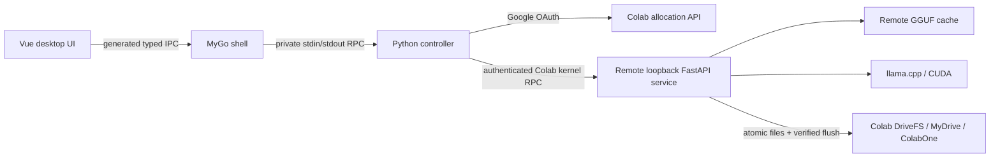

# ColabOne architecture

## Ownership and startup

The OS credential store holds Colab credentials, optional HF token, the exact owned session, and remote bearer. Plain settings contain GPU choice, CU budget, idle timeout and automatic Drive connection preference. Existing Yoga / colab-cli profiles are independent. A Google loopback login with PKCE and state validation returns automatically; a manual flow accepts a raw code, whole page or callback URL. Clipboard text is read only when the user clicks paste.

The exact endpoint is recorded immediately after allocation. A new allocation is released if rate detection, readiness or bootstrap fails. Unrelated assignments are never adopted or released. Failure to verify release retains ownership so the user can retry.

The bootstrap installs the server independently of any model. A separate budget deadline process starts before pip installation. The service binds only to loopback 7860; llama-server binds to loopback 8081. Authenticated Colab kernel executions proxy control requests to the service; POST bodies are uploaded as short-lived files so credentials and prompts are not embedded in notebook source. One lock serializes kernel requests over a reused websocket; proxy-token changes reconnect without replaying mutations. No public inference port or VPN configuration is needed.

## Models and tasks

The HF API resolves revision, sizes and SHA-256 metadata. Import never downloads weight bytes to the desktop. Download jobs fetch directly into the remote cache, resume `.part` files, reject wrong Content-Range and hashes, and atomically publish verified files. Multiple cached models are retained; loading, unloading and switching never remove them. Explicit deletion is blocked for a loaded model or active task.

One task runs at a time. Engine deployment uses pinned release assets and SHA-256, then launches a supervised process with no shell interpolation. The remote engine health endpoint determines readiness. Invalid models and resource failures remain visible as failed tasks.

## Chat and persistence

The remote service owns conversations. It saves the user message before generating and periodically saves partial assistant output, then syncs JSON snapshots to Drive. Events have sequence IDs so desktop incremental polls resume without resubmitting a turn. Reopening the client refreshes remote snapshots; a new GPU restores snapshots from Drive, with all weight installation flags recomputed from the new runtime's actual filesystem.

Drive uses the official `google.colab.drive.mount()` mechanism, also wrapped by easycolab. The desktop implements the official Colab CLI credential-propagation handshake on a worker thread, opens Google's consent URL, polls for completion, then sends a Colab reply to the waiting kernel. The websocket receiver remains unblocked. Cancellation and deadlines always reply with an error. There is no separate Drive API project or OAuth client. Each fresh runtime may need browser consent.

JSON snapshots are written atomically to `/content/drive/MyDrive/ColabOne`; writes refuse to proceed if the mount is missing. Synchronization is serialized, and an update during an upload stays dirty for the next pass. Normal release cancels work, waits for final snapshots, then uses official `drive.flush_and_unmount()` before unassigning. Failed flush blocks normal release. Explicit force release acknowledges potential loss; unexpected Colab eviction may lose unsynced output. Drive access is only available while an owned runtime is mounted; offline client state is not a separate cloud reader. Model weights stay on Colab ephemeral storage.

## Lifetime and budget

One desktop controller monitors the owned instance and sends Colab heartbeats. Remote active download/load/chat prevents idle expiry; polling does not count as use. The independent deadline and the controller's balance check stop ahead of the requested CU budget to allow for release and billing lag. Defaults: T4, 5 CU per runtime, 30-minute idle timeout. Closing the window retains the tray/controller; quitting stops local heartbeat. Remote release protection remains, subject to Colab availability.

## Packaging

Go/MyGo shell, compiled Vue assets, pinned standalone CPython, hash-locked wheels, Python service modules and data manifests form one portable distribution. The two original notebooks/clients and local MCP tools are not required. Python and frontend checks run on both supported platforms; native manual checks and live GPU validation are reported separately.
