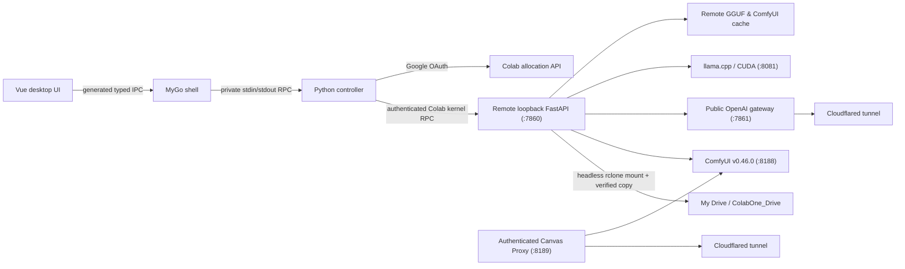

# ColabOne architecture

## Ownership and startup

The OS credential store holds Colab credentials (including `drive.file` refresh token), optional HF token, managed runtime sessions, active endpoint, public API credentials, and per-runtime bearer metadata. Plain settings contain GPU choice, unified idle auto-release timeout (default 30 minutes; selectable `15m`, `30m`, `45m`, `1h`, `2h` from either the homepage dropdown or Settings), automatic Drive mount preference and download concurrency. Existing Yoga / colab-cli profiles are independent. A Google loopback login with PKCE and state validation returns automatically; a manual flow accepts a raw code, whole page or callback URL. Clipboard text is read only when the user clicks paste.

Each owned endpoint is recorded immediately after allocation. Multiple GPUs can be allocated, switched (`runtime.select`), monitored in parallel, and selectively released without affecting instances started in other clients. A new allocation is released if rate detection, readiness or bootstrap fails, restoring the previous active managed instance if one exists. Automatic guards and rollback only release the owned instance. The release review dialog previews every assignment on the current account with hardware specs (`accelerator`, `variant`, `shape`), allowing either selective per-instance release (`endpoints`) or full Stop All, then re-reads assignments and billing. Active and listed instances automatically resolve their geographic country/region (`common/location.py`) from GCP zones and Colab endpoint codes—refined on the VM via GCP metadata (`metadata.google.internal`) and lightweight HTTPS geo fallback, cached in `/content/colabone-data/location.json`—and render built-in vector SVG flags (`FlagIcon.vue`) in the topbar and device views with no external image fetches or OS emoji font dependencies.

The bootstrap installs the control service independently of any model or workflow engine. On the remote VM, loopback bindings are strictly separated by responsibility:
- `127.0.0.1:7860`: private control API (`/api/v1/*`), reached only through authenticated Colab kernel RPC;
- `127.0.0.1:8081`: `llama-server` (`llama.cpp` CUDA engine for GGUF LLMs);
- `127.0.0.1:7861`: separate public OpenAI-compatible text gateway fronted by Cloudflared;
- `127.0.0.1:8188`: `ComfyUI` workflow engine (`v0.46.0`, mutually exclusive in GPU VRAM with `llama-server`);
- `127.0.0.1:8189`: authenticated HTTP + WebSocket reverse proxy for the ComfyUI Native Canvas fronted by Cloudflared.

Authenticated Colab kernel executions proxy control requests to port `7860`; POST bodies are uploaded as short-lived files so credentials, workflows and parameters are not embedded in notebook source. One lock serializes kernel requests over a reused websocket; proxy-token changes reconnect without replaying mutations. No VPN configuration is needed.

## Models and tasks

The desktop organizes sidebar navigation into four stages (`远端设备 → 对外 API → ComfyUI → 设置`). Legacy built-in desktop `聊天`, `画图`, and `视频` interactive pages and `stable-diffusion.cpp` (`Z-Image Turbo`, `Wan2.2 5B`) single-model creative recipes have been removed.

Single-model GGUF selection is integrated directly into `对外 API` via a right-side slide-over drawer (`ModelDrawer.vue`, `common/models.py` accepts only `.gguf` `model`/`shard` manifests) across a streamlined 2-tab layout—**常用模型** (Common Models) and **在线开源社区** (Open-Source Community)—with inline per-card remote download and VRAM status badges, unifying model discovery, common model management, runtime parameters, and VRAM lifecycle directly within the API workflow. Default common repositories (`huihui-ai/Huihui-Qwen3.8-Flash-Next-abliterated-v2-GGUF`, `huihui-ai/Huihui-DeepSeek-V4.1-Flash-1017-abliterated-GGUF`, `JonathanColetti/Qwen3.8-27B-Uncensored`) are seeded once into `library.json`, and users can freely mark community repositories or models as common (`设为常用`) or remove them (`移除常用`) even offline before starting a GPU. The HF API resolves revision, sizes and SHA-256 metadata; import never downloads weight bytes to the desktop. Download jobs fetch directly into the remote cache, resume `.part` files, reject wrong Content-Range and hashes, and atomically publish verified files, optionally chaining directly into remote GPU VRAM load (`load=true`, `下载并装载`) with inline context length (`8K`–`64K`) and temperature settings. Multiple cached models are retained; loading, unloading and quick switching never remove them. Explicit deletion is blocked for a loaded model or active task.

Engine deployment uses pinned release assets and SHA-256, then launches supervised processes with no shell interpolation. Strict VRAM mutual exclusion is enforced between `llama-server` (`8081`) and `ComfyUI` (`8188`): starting or loading one stops/unloads the other before allocating GPU memory while preserving downloaded files. Invalid manifests and resource failures remain visible as failed tasks.

## Persistence and Drive sync

Each remote service owns its workspace metadata, imported workflows and ComfyUI outputs on the remote VM disk (`/content/colabone-data`) and persists them automatically to `My Drive / ColabOne_Drive/workspace` using a hybrid dual-mode strategy with an identical Drive layout:
1. **Headless `rclone` mode (preferred when a Drive-enabled GCP quota project is available)**: When the user's Google account already has a Drive-enabled GCP project or supports auto-provisioning a free `colabone-drive-*` quota project (`X-Goog-User-Project`), ColabOne stages a mode-`0600` `[colabone_gdrive]` OAuth config (`scope = drive.file`) with the quota project directive and mounts/syncs via the pinned SHA-256 `rclone` release (`catalog/rclone.json`) with zero per-instance browser prompts.
2. **Official Google Colab native DriveFS fallback (`colab_drivefs`)**: When Google's public ADC OAuth client (`764086051850-*`) has no available GCP quota project (e.g., personal accounts that have not accepted GCP Terms of Service or Workspace orgs restricting project creation), ColabOne automatically falls back to official `google.colab.drive.mount('/content/drive')` (`dfs_ephemeral` via `bridge/drive_mount.py`) on a dedicated short-lived mount kernel, requiring a one-click browser confirmation per new instance and persisting directly into `/content/drive/MyDrive/ColabOne_Drive/workspace`.

Synchronized paths include `/models.json`, `/workflows/**`, and `/comfyui-outputs/**` (excluding temporary `.part*`/`.tmp*` files and `.trash/**`; deletions move remote workflow/output files into `.trash/`). Normal release shuts down active public/canvas tunnels and engines, flushes dirty workspace files, and unmounts (`google.colab.drive.flush_and_unmount` or FUSE unmount) before unassigning. Model weights stay on Colab ephemeral storage.

The controller refreshes expired runtime-proxy credentials before uploading or executing an RPC and runs its heartbeat before configuration. Kernel identity callbacks merge into the still-owned session instead of writing stale credentials or resurrecting a released session. Failed mutations are not replayed. The native private bridge decodes a JSON stream rather than imposing a line-length limit on large snapshots or chunked asset reads. Workflow output previews and exports validate transfer metadata, MIME allowlists, size and SHA-256 before returning content.

## Lifetime, telemetry and billing

One desktop controller monitors the owned instance and sends Colab heartbeats. Single-launch CU budgets (`max_cu`) and mandatory per-runtime budget deadlines have been removed; automatic resource protection uses a unified configurable idle auto-release countdown defaulting to **30 minutes** (options: `15m`, `30m`, `45m`, `1h`, `2h`), adjustable directly from the homepage (`远端设备`) dropdown or Settings (`设置`). Default GPU selection remains T4. Active remote work—downloads, VRAM loads, external API inference requests, and active ComfyUI queue runs or authenticated canvas proxy requests—pauses the idle auto-release countdown; status/snapshot polling and heartbeats never count as use. Trusted pointer/key/scroll interactions enqueue a throttled activity command that resets the idle countdown, and a bounded lease protects Drive operations when needed. Expiry is enforced by the remote service, so idle auto-release continues working if the desktop UI exits. Closing the window retains the tray/controller; quitting stops local heartbeats while remote idle release protection remains active, subject to Colab availability.

On the remote VM, `server/telemetry.py` (`ColabOneResourceSampler`) samples live hardware metrics—`gpu` utilization and VRAM, system `memory` from `/proc/meminfo`, `disk` capacity plus `/proc/diskstats` I/O throughput rate, `cpu` utilization from `/proc/stat`, and a 60-sample rolling `history`—and returns them under `resources` in `/api/v1/status` (and `/api/v1/snapshot`). On the desktop client, `ResourceMonitor.vue` renders ColabOne real-time hardware charts on the `远端设备` view without resetting idle state, with an instance selector dropdown defaulting to this client's active managed GPU and automatically falling back to the first running remote account instance (preferring GPUs) when no local instance is active. External ("其他来源") instances are observed strictly read-only via a dedicated isolated observer kernel (preferring an existing remote ColabOne `/api/v1/status` or zero-dependency `/proc` + `nvidia-smi` sampling without adopting sessions, writing files, or sending keep-alive pings), with one-click pause/resume and automatic kernel teardown when switching away or exiting.

## Packaging

ColabOne is distributed under **GNU GPL-3.0** (matching ComfyUI) while preserving all upstream Apache-2.0 and MIT attribution notices (`NOTICE`, `third_party/SOURCES.md`). Go/MyGo shell, compiled Vue assets, pinned standalone CPython, hash-locked wheels, Python service modules and data manifests form one portable distribution. Neither model weights nor ComfyUI binaries/source are bundled in the desktop client; local MCP tools are not shipped. Python and frontend checks run on both supported platforms; native manual checks and live GPU validation are reported separately.

## Desktop activity and saved login

Colab refresh tokens are stored in the OS vault. Refresh is serialized with account changes, and network errors retain saved authorization. The UI confirms whether automatic renewal is available. Native Drive grants remain runtime-specific; this is not a promise of permanent browserless Drive access.

A bounded 300-event desktop feed records lifecycle stages, remote task state changes and download transfer statistics every five seconds, file transitions, retries, SHA-256 checks and task completion. It never records prompts, HTTP bodies, API keys, canvas tokens or authorization URLs; displayed errors are redacted. Identical polls do not append entries. The overlay drawer preserves workspace geometry and follows new entries until the user scrolls back, provides error filtering/copy/clear, and retains its open preference. The live feed holds the latest 300 events in memory and mirrors the same credential-redacted lines to a bounded rotating `activity.log` file (mode `0600`) inside the local config directory for post-mortem diagnostics. Billing refreshes the account assignment list, hourly CU burn rate (`CU/h`), and remaining CU balance separately from runtime snapshots, displaying real-time billing status (active vs. idle), `CU/h` burn rate, remaining CU balance, and human-friendly estimated remaining runtime (`X 天 Y 小时` / days & hours) in both the persistent top bar and the homepage (`远端设备`) overview card. Stale data stays visibly marked, and an absent owned runtime never implies a zero account rate.

## Parallel download and online catalog

`common/hub.py` queries only HF metadata, with GGUF filtering, bounded pagination and pinned commit revisions. Complete split GGUF sets are grouped into one choice; missing hashes/shards disable installation. Weight requests always originate on the GPU.

`server/download.py` adapts upstream's 64 MiB range / thread-pool approach. The pool is bounded to 16 or 32 workers per file (default 16). Completed ranges are fsynced before atomic resume metadata; sparse preallocation never counts as completed bytes. Cancellation retains completed ranges, old sequential partials can resume, ignored Range responses fall back to a single connection, malformed ranges cannot publish data. SHA-256 gates final atomic rename. A rolling wire-byte window reports rate, bytes, connections and ETA; resumed bytes do not inflate rate.

Protocol `7` advertises `capabilities: ["public_api", "comfyui"]` alongside live `resources` telemetry and the unified idle auto-release policy. Older live services can update in place (`server/vm_update.py`) only when no running task, loaded model, or active engine (including ComfyUI) is present, preserving `/content/colabone-data`, the control token and the active idle auto-release configuration. A failed new service launch (failing to reach protocol `>= 7`) automatically restores the previous code.

## Public inference and Cloudflare (LLM OpenAI API)

`server/public_api.py` and `server/openai_compat.py` run a separate ASGI application on remote `127.0.0.1:7861` with mandatory external Bearer authentication and OpenAI-compatible LLM routes (`GET /v1/models`, `GET /v1/models/{id}`, `POST /v1/chat/completions`, `POST /v1/responses`, `GET`/`DELETE /v1/responses/{id}`, and `POST /v1/responses/compact` for Codex context compaction). It translates OpenAI Responses API items (including `function` and `custom`/`apply_patch` tools, reasoning summaries, and stateless portable `compaction` payloads) onto the loaded `llama-server` engine (`8081`, launched with `--jinja`) while sharing the Runtime task lock. Active inference and compaction requests pause the idle auto-release countdown, while model-list/status polling does not. Turning off the API cancels its jobs, clears the bounded in-memory response cache, and terminates only its owned connector, preserving the loaded model. Releasing the runtime or switching GPU VRAM to ComfyUI closes/unloads cleanly as required. Restarting/upgrading the remote service leaves public access off until explicitly enabled again.

`server/tunnel.py` installs the architecture-specific Cloudflared `2026.11.0` release on the GPU, verifying the GitHub release SHA-256 from `catalog/cloudflared.json`. No desktop tunnel process or local inference is installed. Only remotely managed Named Tunnels (fixed public HTTPS domains) are supported; temporary `trycloudflare.com` Quick Tunnels are disabled. Named tunnel tokens use a mode-`0600` token file, never command arguments, and are removed on stop/failure. Raw connector logs are not retained. Startup and periodic probes verify the public identity and both unauthorized/authenticated behavior; a log containing a URL alone never means ready. Shutdown signals only the Popen child; it does not use global `pkill` or adopt another project's connector. Both streamed (`stream=true`) and non-streamed (`stream=false`) requests are supported.

## ComfyUI workflow studio and native canvas (Protocol 7)

Protocol `7` integrates **ComfyUI** by Comfy-Org (GPL-3.0), pinned to tag `v0.46.0` (commit `a277b5bf213e8a44fa34817b7770b54f86ef4cea`), fetched and executed exclusively on the remote Colab GPU runtime (`127.0.0.1:8188`). The standalone `ComfyUI` sidebar workspace implements a dual-layer Mode 3 experience:

1. **Workflow Studio (`工作流工坊`, Phase 1 universal foundation)**:
   - **Workflow import & persistence**: Imports ComfyUI API-format JSON graphs (node-ID keyed objects with `class_type` and `inputs`; canvas-format graphs containing a top-level `nodes` array are rejected with instructions to export via ComfyUI `Save (API Format)`). Saved workflows live under `/content/colabone-data/workflows/**` and sync automatically to `ColabOne_Drive/workspace/workflows/**`.
   - **Auto-generated forms & media upload**: Introspects workflow nodes and ComfyUI node definitions to auto-generate typed desktop parameter forms (`string`, `integer`, `number`, `boolean`, `select`, media inputs), with validated remote media uploads for reference/input assets.
   - **Cancellable remote execution**: Submits workflow prompts to ComfyUI's loopback HTTP/WebSocket API (`127.0.0.1:8188`) under the Runtime task model, streaming node execution progress and supporting cooperative cancellation / interruption.
   - **SHA-256 verified output gallery & native export**: Outputs are captured with random 32-hex IDs, MIME/size/SHA-256 metadata under `/content/colabone-data/comfyui-outputs/**`, and synced to `ColabOne_Drive/workspace/comfyui-outputs/**`. Desktop previews (`frontend/src/comfyui.ts`) read bounded 512 KiB chunks, block unsafe active MIME types (`image/svg+xml`, HTML, JS), and verify SHA-256 in memory; native exports (`ExportWorkflowOutput(id)` in `console/comfyui.go`) use an OS save dialog, accept only remote artifact IDs (max 512 MiB, allowlisted image/video/audio extensions), verify full SHA-256, and atomically publish the file.
   - **Extensible pack catalog**: Remote ComfyUI model/workflow packs are described declaratively in `catalog/comfyui.json` (data-only manifests with pinned revisions and SHA-256 verification; remote-only downloads).

2. **Native Canvas (`原生画布`, Authenticated Reverse Proxy + Tunnel)**:
   - Runs an authenticated HTTP + WebSocket reverse proxy on remote `127.0.0.1:8189` forwarding traffic to ComfyUI on `127.0.0.1:8188`, exposed exclusively via a fixed-domain Named Cloudflared tunnel (`server/comfy_proxy.py` + `server/tunnel.py`).
   - Authentication uses a random per-session token exchanged at `/_colabone_auth?token=<token>` to issue an `HttpOnly` session cookie; unauthenticated HTTP and WebSocket requests are rejected.
   - On the desktop, `OpenComfyCanvas(target)` (`console/comfyui.go`) retrieves the authenticated HTTPS URL solely from the trusted Python bridge (`comfyui.canvas.url`), strictly validates HTTPS scheme, non-loopback host, `/_colabone_auth` path, and non-empty token, and opens either a reusable dedicated desktop window (`StateKey: "comfyui-canvas"`) or the system browser (`target: "window" | "browser"`).

3. **VRAM mutual exclusion & idle protection**:
   - `llama-server` (`8081`) and `ComfyUI` (`8188`) never share GPU VRAM simultaneously; starting ComfyUI unloads any loaded LLM (and vice versa) while retaining cached weights on remote disk.
   - Active ComfyUI execution queues, pack/model downloads, and authenticated canvas proxy HTTP/WebSocket traffic pause the 30-minute idle auto-release countdown. Stopping ComfyUI or releasing the runtime tears down the canvas tunnel, proxy (`8189`), and ComfyUI process (`8188`) cleanly before flushing `ColabOne_Drive`.
