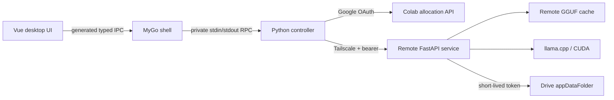

# ColabOne architecture

## Ownership and startup

The OS credential store holds Colab credentials, Drive refresh credentials, Tailscale OAuth credentials, optional HF token, the exact owned session, and remote bearer. Plain settings contain GPU choice, CU budget and idle timeout only. Existing Yoga / colab-cli profiles are independent.

Startup checks local Tailscale, Drive authorization and Tailscale key generation before allocating. The exact endpoint is recorded immediately. A new allocation is released if rate detection, readiness or bootstrap fails. Unrelated assignments are never adopted or released. Failure to verify release retains ownership so the user can retry.

The bootstrap installs the server and Tailscale independently of any model. A separate budget-deadline process starts before pip installation. Only the authenticated remote service is reachable on tailnet TCP 7860; llama-server binds to loopback 8081. Private API traffic bypasses system HTTP proxies.

## Models and tasks

The HF API resolves revision, sizes and SHA-256 metadata. Import never downloads weight bytes to the desktop. Download jobs fetch directly into the remote cache, resume `.part` files, reject wrong Content-Range and hashes, and atomically publish verified files. Multiple cached models are retained; loading, unloading and switching never remove them. Explicit deletion is blocked for a loaded model or active task.

One task runs at a time. Engine deployment uses pinned release assets and SHA-256, then launches a supervised process with no shell interpolation. The remote engine health endpoint determines readiness. Invalid models and resource failures remain visible as failed tasks.

## Chat and persistence

The remote service owns conversations. It saves the user message before generating and periodically saves partial assistant output, then syncs JSON snapshots to Drive. Events have sequence IDs so desktop SSE reconnects resume without resubmitting a turn. Reopening the client refreshes remote snapshots; a new GPU restores snapshots from Drive, with all weight installation flags recomputed from the new runtime's actual filesystem.

Drive uses `drive.appdata` and a separate Desktop OAuth authorization with PKCE and loopback callback. Only short-lived access tokens reach the remote machine. Tokens refresh while the desktop runs. Unsynced state is visible. Normal release blocks on failed sync; explicit force release acknowledges potential loss. Unexpected Colab eviction can lose unsynced output.

## Lifetime and budget

One desktop controller monitors the owned instance and sends Colab heartbeats. Remote active download/load/chat prevents idle expiry; polling does not count as use. The independent deadline and the controller's balance check stop ahead of the requested CU budget to allow for release and billing lag. Defaults: T4, 5 CU per runtime, 30-minute idle timeout. Closing the window retains the tray/controller; quitting stops local heartbeat. Remote release protection remains, subject to Colab availability.

## Packaging

Go/MyGo shell, compiled Vue assets, pinned standalone CPython, hash-locked wheels, Python service modules and data manifests form one portable distribution. The two original notebooks/clients and local MCP tools are not required. Python and frontend checks run on both supported platforms; native manual checks and live GPU validation are reported separately.
